<div align="center">



<br/>


<br/>


<br/>


<br/><br/>

[**⚡ Quick Start**](#-quick-start) &nbsp;·&nbsp;
[**🚀 Modules**](#-modules) &nbsp;·&nbsp;
[**🏗️ Architecture**](#️-architecture) &nbsp;·&nbsp;
[**🧰 Tech Stack**](#-tech-stack) &nbsp;·&nbsp;
[**🗄️ Datasets**](#️-datasets) &nbsp;·&nbsp;
[**🛠️ Troubleshooting**](#️-troubleshooting)

</div>


## 🌌 About

**Space ML Mission Control** is one web app for doing machine learning on **real space data**: NASA, ESA, STScI and JPL sources, never synthetic demos. It lets you replay real space events, compare ML models with **simple, honest baselines** on held-out data, review every result by hand, and export the evidence.

The React dashboard and the FastAPI backend run as **one app on one origin**, either with a single `docker compose up -d` or natively for development. It ships a **sha256-verified starter pack** (all 81 SMAP/MSL telemetry channels, a trained model for each, the full ESA OPS-SAT release and reference runs), so the core features work **offline within seconds** of the first start.

<div align="center">
  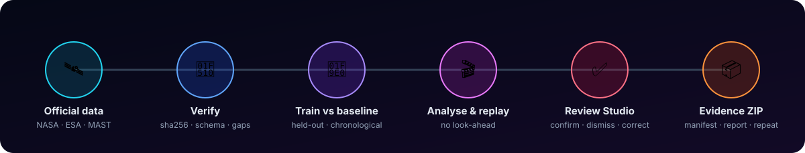
</div>

### 🎯 What makes it different

| Principle | How the app enforces it |
| :--- | :--- |
| 🧪 **Model vs baseline, always** | Every model is scored against a simple baseline (persistence, z-score, gradient boosting, "all soil") on held-out data. |
| ⏱️ **No look-ahead** | Mission Replay recomputes a forecast with all later data removed; the result must be identical, or the "no look-ahead" badge is withheld. |
| 📅 **Chronological splits** | Space weather trains on 2010–2016 and tests on 2017. Overlapping splits are refused, and in-sample replays are flagged. |
| 🔍 **Data quality first** | Missing hours, gaps and stale readings are shown *before* the result. |
| 👩‍🚀 **Humans decide** | Flags, regions, candidates and masks go to **Review Studio** to be confirmed, dismissed or corrected. |
| 📦 **Reproducible evidence** | Every run exports a ZIP with a manifest (data sha256, model version, split, metrics, reviews) and can be **repeated** and compared value by value. |


## 🚀 Modules

<table>
<tr>
<td width="50%" valign="top">

### 🎬 Mission Replay &nbsp;<sub>flagship</sub>
Step through the **May 2024 Gannon superstorm** (and 9 other storms) hour by hour. A gradient-boosting Dst forecaster (+1 to +24 h) is issued with no look-ahead and compared with **persistence**: what happened, what the model could know at the time, and where the baseline did better.

</td>
<td width="50%" valign="top">

### 📡 Telemetry & Missions
**NASA SMAP + Curiosity (MSL)** telemetry with 105 expert-labelled anomalies: a per-channel **LSTM + dynamic threshold** against a z-score. Plus **ESA OPS-SAT** (RandomForest on the 18 published features), and **Hubble / James Webb** pointing with Isolation Forest and a **live "what is the telescope observing now"** panel.

</td>
</tr>
<tr>
<td valign="top">

### 🪐 Exoplanet Finder
Kepler DR24 TCEs and MAST light curves, or your own uploads. A **1D CNN** against gradient boosting, with **BLS** period search, odd/even and secondary-eclipse checks, and a 3D system and sky view.

</td>
<td valign="top">

### 🔴 Mars Terrain + Rover Traverse
**AI4Mars** segmentation with **DeepLabV3+** against an "all soil" baseline. Follow **Curiosity's waypoints** on a map, pull the Navcam frames for any sol, segment them and correct the masks.

</td>
</tr>
<tr>
<td valign="top">

### ☀️ Space Weather Explorer
**OMNI2 hourly solar wind + Dst from 1963 onward.** Dst forecasts against persistence on a chronological split, with storm replays and annotations.

</td>
<td valign="top">

### 🧪 Data Workbench
Bring your own **CSV / XLSX / JSON / Parquet / FITS / PNG / GeoTIFF / ZIP** (up to 1 GB). It detects the data type, recommends and runs an analysis: time-series anomaly flags, change detection in km² (NDWI water mode), image classification, terrain segmentation or transit search.

</td>
</tr>
<tr>
<td valign="top">

### ✅ Review Studio
One queue for every flag, interval, change region, transit candidate and terrain mask. **Confirm · dismiss · correct**, then export the reviewed labels as CSV, JSON or ZIP to retrain.

</td>
<td valign="top">

### 📊 Data & Training · Evaluation · Run History
A dataset catalog with **Dataset ready** and **Model status** shown separately for each module, **Quick run** and **Full training** buttons, a job queue on capped CPU with resume, model metrics against baselines, and every saved result.

</td>
</tr>
</table>

<details>
<summary><b>📸 Screenshots</b></summary>
<br/>

| Welcome (dark) | Overview |
| :---: | :---: |
| 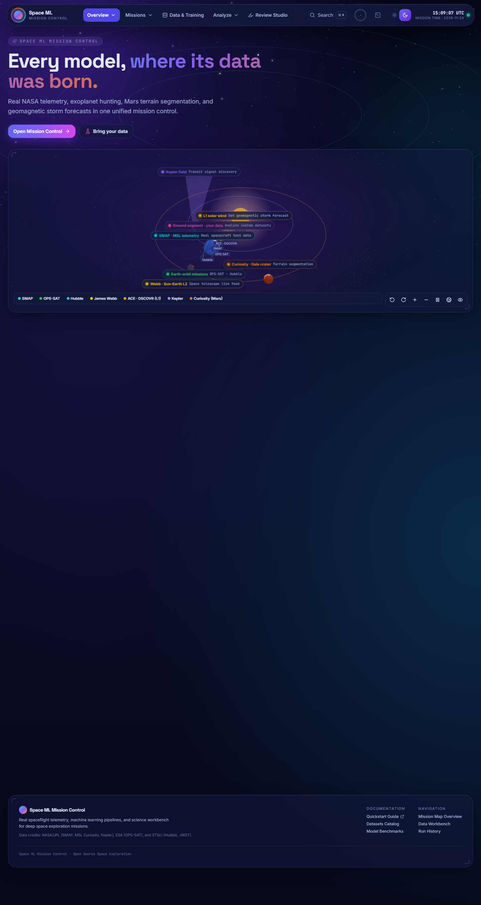 |  |
| **Anomaly detection** | **Exoplanet 3D** |
| 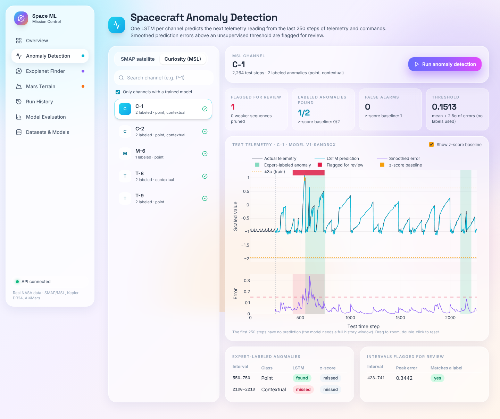 | 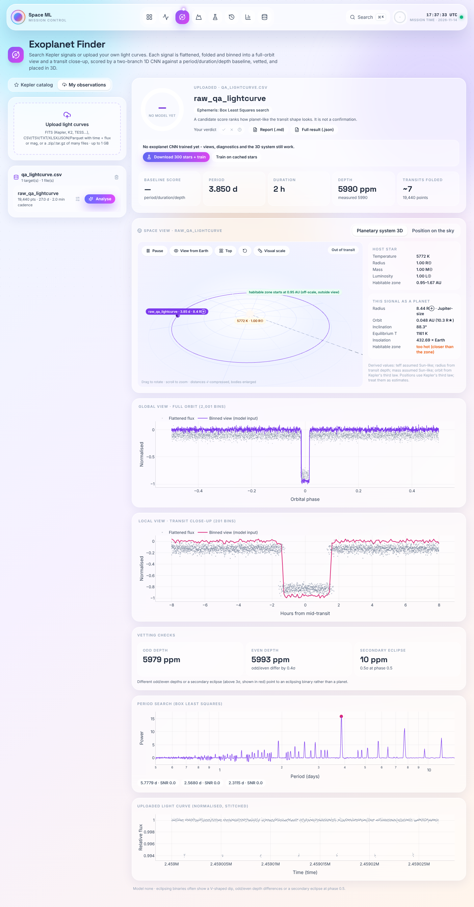 |
| **Data Workbench** | **Data & Training** |
| 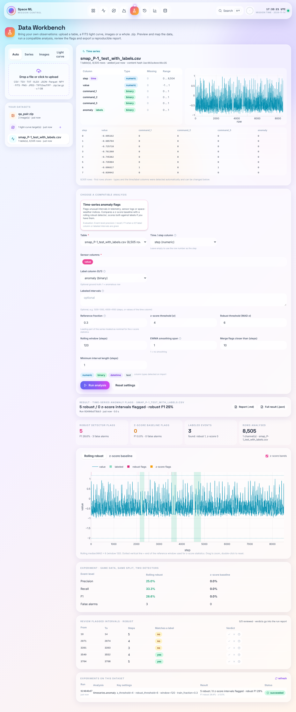 | 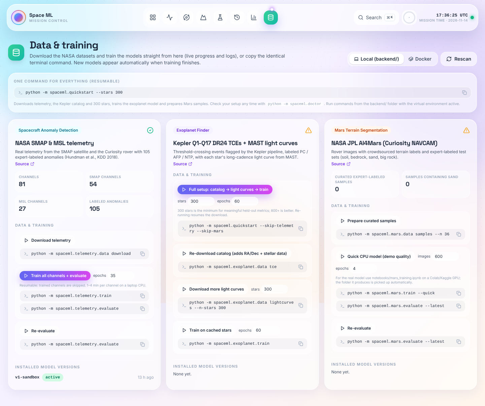 |

</details>

### 🧭 App routes

| Route | Page | Route | Page |
| :--- | :--- | :--- | :--- |
| `/welcome` | ✨ Project tour | `/space-weather` | ☀️ Space Weather |
| `/` | 🗺️ Overview + 3D mission map | `/workbench` | 🧪 Data Workbench |
| `/replay` | 🎬 Mission Replay | `/review` | ✅ Review Studio |
| `/telemetry` | 📡 Telemetry & Missions | `/runs` | 🕘 Run History |
| `/exoplanet` | 🪐 Exoplanet Finder | `/evaluation` | 📊 Evaluation |
| `/mars` · `/mars/traverse` | 🔴 Mars Terrain · Rover Traverse | `/datasets` | 🗄️ Data & Training |

API docs (Swagger UI) are served at **`/docs`**, and the API itself under **`/api`**.


## 🏗️ Architecture

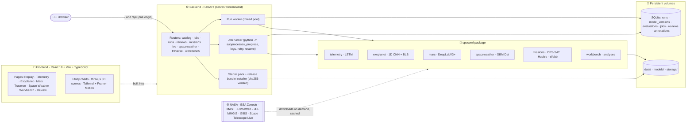

### 🛫 What happens on the first launch

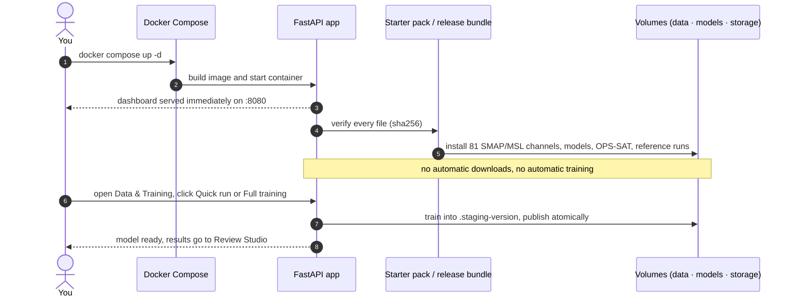

### 🔄 Job lifecycle

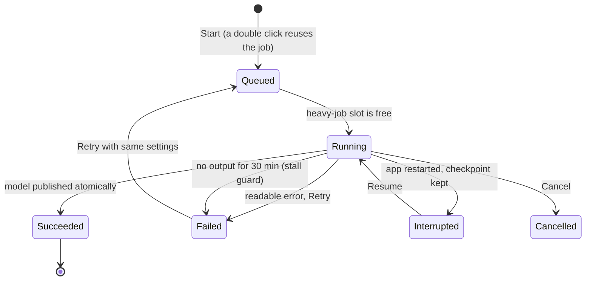

> The last working model stays active until a better one is published, and a full run always beats a quick one. A failed or cancelled job never replaces a working model.


## 🧰 Tech Stack

| Layer | Technology | What it does here |
| :--- | :--- | :--- |
| 🎨 **UI framework** | React 18 · TypeScript 5.6 · React Router 6 | Single-page dashboard with grouped navigation and a command palette |
| ⚡ **Build tool** | Vite 5 | Dev server with API proxy, production build served by FastAPI |
| 💅 **Styling** | Tailwind CSS 3 · Framer Motion · Lucide icons | Dark/light themes, animations that respect reduced motion |
| 📈 **Charts** | Plotly.js (react-plotly.js) | Telemetry, light curves, Dst forecasts, metric comparisons |
| 🌍 **3D** | three.js | Mission map, Earth system, exoplanet systems, sky scenes |
| ⚙️ **API** | FastAPI · Uvicorn · Pydantic 2 · httpx | REST API, job runner, starter-pack installer, live telescope proxy |
| 🧠 **Deep learning** | PyTorch 2.6 + torchvision 0.21 (CPU) · segmentation-models-pytorch | Telemetry LSTMs, exoplanet 1D CNN, Mars DeepLabV3+ |
| 🤖 **Classical ML** | scikit-learn · SciPy · NumPy · pandas · joblib | Gradient boosting, RandomForest, Isolation Forest, baselines |
| 🔭 **Astronomy & geo** | Astropy · lightkurve · rasterio | FITS (Kepler, HST jitter, JWST FGS), MAST light curves, GeoTIFF change detection |
| 🤗 **Datasets** | Hugging Face `datasets` · PyArrow · openpyxl | AI4Mars loading, Parquet and XLSX uploads |
| 💾 **Storage** | SQLite + Docker named volumes | Runs, model versions, evaluations, jobs, reviews, annotations |
| 🐳 **Delivery** | Docker (multi-stage: `node:20-alpine` → `python:3.11-slim`) · Docker Compose | One image, one origin, CPU PyTorch (about 1–1.5 GB) |
| 🔁 **CI** | GitHub Actions (`image.yml`) | Publishes `ghcr.io/<owner>/space-ml-mission-control:<tag>` on `v*` tags |
| 🧪 **Testing** | pytest · end-to-end audit scripts · axe-core | Offline test suite, deployment audit, accessibility checks |
| 📓 **GPU training** | Jupyter (`notebooks/mars_training.ipynb`) | Train the Mars model on Colab or Kaggle and upload `mars_model.zip` |


## 📁 Project Structure

```text
SpaceML/
├── 🐳 Dockerfile                    # multi-stage: build dashboard → API + pipelines (CPU torch)
├── 🐳 docker-compose.yml            # app (port 8080) + optional "tools" profile
├── 🐳 docker-compose.offline.yml    # network-isolated run used by the audit
├── ⚙️ .env.example                  # port, autosetup, CPU caps, Mars weights URL
├── 📋 DATASETS-MANIFEST.json
├── backend/
│   ├── app/                         # FastAPI: main, jobs, worker, starter, db, routers/
│   ├── spaceml/                     # ML package
│   │   ├── telemetry/  exoplanet/  mars/  spaceweather/
│   │   ├── missions/   workbench/  common/
│   │   └── doctor.py · quickstart.py · release.py · audit.py
│   ├── tests/                       # pytest suite (offline)
│   └── requirements*.txt            # core + ML requirements
├── frontend/
│   ├── src/pages/                   # Welcome, Overview, MissionReplay, Telemetry, Exoplanet, Mars, …
│   ├── src/components/              # MissionMap, SystemScene, MaskEditor, Evidence, Jobs, …
│   └── src/lib/                     # api client, nav, theme, types
├── starter/                         # sha256-checked starter pack: SMAP/MSL models + reference runs
├── release/bundle/                  # optional full offline release bundle
├── samples/                         # real SMAP/MSL test CSVs with NASA anomaly labels
├── notebooks/mars_training.ipynb    # GPU training on Colab / Kaggle
├── scripts/                         # setup, dev, audit (.sh + .ps1), release ZIP
├── docs/screenshots/
└── assets/                          # README banner and animated SVGs
```


## ⚡ Quick Start

### ✅ Prerequisites

| Path | You need |
| :--- | :--- |
| 🐳 **Docker (recommended)** | [Docker Desktop](https://www.docker.com/products/docker-desktop/) or Docker Engine + Compose v2, **4 GB+ memory** for Docker, **3 GB free disk** |
| 💻 **Native dev** | **Python 3.10–3.12**, **Node.js 18+** (npm), Git |
| 🎮 **GPU (optional)** | Only for Mars training: use the Colab/Kaggle notebook |

No API keys and no GPU are needed.

### 1️⃣ Clone the repository

```bash
git clone https://github.com/LoganthP/SpaceML.git
cd SpaceML
```

### 2️⃣ Start the app

<details open>
<summary><b>🐳 Option A: Docker, one command (recommended)</b></summary>
<br/>

```bash
# optional: copy the settings file (the defaults work without it)
cp .env.example .env              # Windows PowerShell: Copy-Item .env.example .env

# build and start (the first build takes about 5–10 minutes)
docker compose up -d

# follow the logs until the app reports it is ready
docker compose logs -f app
```

Then open:

| URL | What |
| :--- | :--- |
| **http://localhost:8080** | 🛰️ Dashboard |
| **http://localhost:8080/welcome** | ✨ Project tour |
| **http://localhost:8080/docs** | 📘 API docs (Swagger) |

Everyday commands:

```bash
docker compose ps                 # status and health
docker compose restart app        # restart (jobs come back as "interrupted" with Resume)
docker compose down               # stop; your data, models and runs are kept in volumes
docker compose up -d --build app  # upgrade after pulling new code; volumes are reused
docker compose down -v            # ⚠️ full reset: deletes all data volumes
```

> 💡 Port 8080 busy? Run `SMC_PORT=8081 docker compose up -d` (or set `SMC_PORT` in `.env`).
> On Windows PowerShell: `$env:SMC_PORT=8081; docker compose up -d`.

</details>

<details>
<summary><b>💻 Option B: Native development (React/Vite + FastAPI, hot reload)</b></summary>
<br/>

**One-time setup** (virtual env, backend and frontend dependencies, telemetry data, sample files, health check):

```bash
# macOS / Linux
./scripts/setup.sh

# Windows PowerShell
.\scripts\setup.ps1
```

**Start both servers** (Ctrl+C stops both):

```bash
# macOS / Linux
./scripts/dev.sh

# Windows PowerShell
.\scripts\dev.ps1
```

| URL | What |
| :--- | :--- |
| **http://localhost:5173** | 🎨 Dashboard (Vite, proxies `/api`) |
| **http://localhost:8000/docs** | 📘 API docs |

</details>

<details>
<summary><b>🔧 Option C: Manual steps (two terminals)</b></summary>
<br/>

```bash
# Terminal 1: backend
python -m venv .venv
source .venv/bin/activate                     # Windows: .venv\Scripts\activate
pip install torch --index-url https://download.pytorch.org/whl/cpu   # CPU wheels (Linux without GPU)
pip install -r backend/requirements.txt
cd backend
uvicorn app.main:app --reload --reload-dir app --reload-dir spaceml --port 8000
```

```bash
# Terminal 2: frontend
cd frontend
npm install
npm run dev                                   # http://localhost:5173
```

Serve the built dashboard from the API, as Docker does:

```bash
cd frontend && npm run build                  # then open http://localhost:8000
```

</details>

### 3️⃣ Use it

1. 🗄️ Open **Data & Training** (`/datasets`). SMAP/MSL and OPS-SAT already show **Ready** from the starter pack.
2. ⬇️ Click **Download** / **Install data** on any other dataset card (OMNI2, Kepler, AI4Mars, waypoints).
3. 🧠 Click **Quick run (pipeline check)** to prove a pipeline in minutes, or **Full training** for the real model.
4. 🎬 Open **Mission Replay** and drag the issuance time through the May 2024 storm.
5. ✅ Confirm or dismiss the results in **Review Studio**, then download the **Evidence ZIP** from any run.

### 4️⃣ Run the tests

```bash
cd backend
python -m pytest -q               # offline, no network needed
```

```bash
cd frontend
npm run typecheck                 # TypeScript check
npm run build                     # production build
```


## ⚙️ Configuration

All settings are optional. Copy `.env.example` to `.env` to change them.

| Variable | Default | Purpose |
| :--- | :--- | :--- |
| `SMC_PORT` | `8080` | Host port for the dashboard + API |
| `SMC_IMAGE` | `space-ml-mission-control:3.1.9` | Use a published image (e.g. `ghcr.io/<you>/space-ml-mission-control:<tag>`) to skip the build |
| `SPACEML_AUTOSETUP` | `off` | `off` · `light` · `full`: opt-in background download and training |
| `SPACEML_TRAIN_CPUS` | all but one | CPUs one training job may use |
| `SPACEML_HEAVY_JOBS` | `1` | Training jobs that run at the same time |
| `SPACEML_JOB_STALL_MINUTES` | `30` | Stop a job that shows no progress for this long |
| `SPACEML_MARS_WEIGHTS_URL` | empty | HTTPS link to a GPU-trained `mars_model.zip` |
| `TORCH_INDEX` | CPU wheel index | Set `none` for a **lite image** without PyTorch |
| `SMC_AUTO_INSTALL` | `on` | Fetch small mission datasets (OPS-SAT, Hubble, Webb) when online; `off` for a fully offline start |
| `SMC_LIVE_MAX_AGE` | `120` | Seconds between Hubble/Webb live-view refreshes |

<details>
<summary><b>🧠 Data & training commands (optional, for contributors)</b></summary>
<br/>

In Docker you never need these: the **Data & Training** page runs them as background jobs with progress, ETA, logs, cancel and Retry. Run them from `backend/` locally, or prefix them with `docker compose exec app`.

| Step | Command |
| :--- | :--- |
| 🩺 Health check | `python -m spaceml.doctor` |
| ☀️ Space weather: download → train → replay | `python -m spaceml.spaceweather.data download --years 2010 2011 2012 2013 2014 2015 2016 2017 2024 && python -m spaceml.spaceweather.forecast --if-missing && python -m app.starter replay --event 2024-05` |
| 📥 Import OMNI files you downloaded | `python -m spaceml.spaceweather.data import omni2_2024.dat` |
| 🗺️ Curiosity waypoints | `python -m spaceml.mars.traverse download` |
| 📡 Full telemetry + train all channels (fast) | `python -m spaceml.telemetry.data download && python -m spaceml.telemetry.train --fast --version v1-sandbox && python -m spaceml.telemetry.evaluate --version v1-sandbox` |
| 🪐 Kepler catalog + light curves + CNN | `python -m spaceml.quickstart --skip-telemetry --skip-mars --stars 300` |
| 🔴 AI4Mars local dataset | `python -m spaceml.mars.local build --train 3000 --test all` · check: `python -m spaceml.mars.local check` |
| 🔴 Mars samples / quick / resume | `python -m spaceml.mars.data samples --n 36` · `python -m spaceml.mars.train --quick` · `--resume` |
| 🛰️ Prepare mission sources | `python -m spaceml.missions.prepare opssat --download v2 --from /app/data/missions-source/opssat` · `hubble --from /app/data/src/hst` · `webb --from /app/data/src/jwst` |
| 🌊 Satellite before/after samples | `python -m spaceml.workbench.samples imagery` |
| 📦 Starter pack status / rebuild | `python -m app.starter status` · `python -m app.starter build --with-network` |
| 📦 Release bundle | `python -m spaceml.release build --out ../release/bundle` · `verify` · `install` |

</details>

<details>
<summary><b>📦 Full offline deployment (release bundle)</b></summary>
<br/>

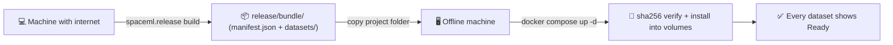

Build once on a machine with internet:

```bash
docker compose --profile tools run --rm tools python -m spaceml.release build --out /bundle-out
# or package what you already have, including trained models:
docker compose --profile tools run --rm tools python -m spaceml.release build --out /bundle-out --from-data --include-models
```

On Linux, if the bind mount is not writable: `mkdir -p release/bundle && chmod a+rwx release/bundle`.

Copy the project folder with `release/bundle/` to the target and run `docker compose up -d`. With the defaults the bundle is roughly **1–1.5 GB**; allow about **2× the bundle size + 3 GB** free disk. AI4Mars is marked `verify` in the manifest: confirm its licence before handing the bundle to third parties.

</details>

<details>
<summary><b>🔍 Deployment audit</b></summary>
<br/>

```bash
./scripts/audit.sh                # Windows: .\scripts\audit.ps1   (-Backup saves the volumes first)
```

It runs the full acceptance check against the real container on `localhost:8081` with external network cut off: volume mounts, rebuild with the matched CPU torch/torchvision pair, runtime checks, a data inventory, quick training for each module, restart persistence, and a report in `audit-results/report.md`.

</details>


## 🗄️ Datasets

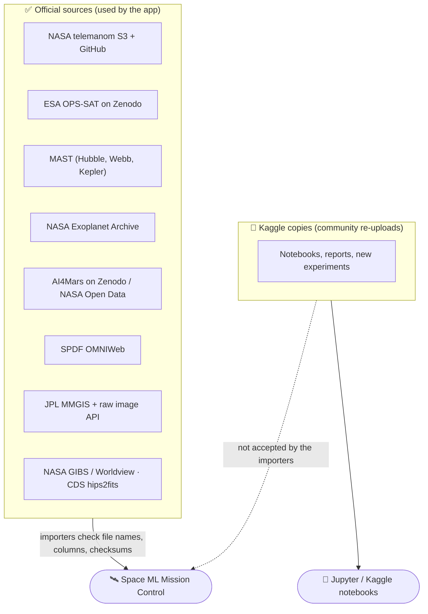

> ⚠️ The app downloads from the **official sources** below. Its importers check file names, column layouts and checksums, so Kaggle copies (community re-uploads) suit notebooks and reports, not the app.

### 🛰️ Datasets used by the app

| Module | Official source (used by the app) | Kaggle copy | Notes |
| :--- | :--- | :--- | :--- |
| 📡 Spacecraft telemetry: NASA SMAP / MSL | [telemanom data.zip](https://s3-us-west-2.amazonaws.com/telemanom/data.zip) + [labeled_anomalies.csv](https://raw.githubusercontent.com/khundman/telemanom/master/labeled_anomalies.csv); code: [telemanom](https://github.com/khundman/telemanom) | [patrickfleith/nasa-anomaly-detection-dataset-smap-msl](https://www.kaggle.com/datasets/patrickfleith/nasa-anomaly-detection-dataset-smap-msl) | The telemanom README itself downloads this Kaggle copy |
| 🛰️ ESA OPS-SAT (OPSSAT-AD) | Zenodo [v1](https://zenodo.org/records/12588359) (in the starter pack) and [v2](https://zenodo.org/records/15108715); code: [OPS-SAT-AD](https://github.com/kplabs-pl/OPS-SAT-AD) | None found | `segments.csv` (telemetry) + `dataset.csv` (labelled segment features); [paper](https://arxiv.org/abs/2407.04730), DOI 10.1038/s41597-025-05035-3 |
| 🔭 Hubble and James Webb pointing | [MAST](https://mast.stsci.edu) (Hubble `*_jit/*_jif.fits`, Webb FGS `*gs-fg*_cal.fits`); live data: [Space Telescope Live](https://spacetelescopelive.org) | None | Formats: [Hubble jitter files](https://www.stsci.edu/hst/instrumentation/focus-and-pointing/pointing/jitter-file-format-definition), [Webb guiding](https://jwst-docs.stsci.edu/jwst-observatory-characteristics/jwst-pointing-performance/jwst-fine-guide-stability) |
| 🪐 Kepler exoplanets | [NASA Exoplanet Archive](https://exoplanetarchive.ipac.caltech.edu) (KOI cumulative table, DOI 10.26133/NEA4); light curves from MAST | [nasa/kepler-exoplanet-search-results](https://www.kaggle.com/datasets/nasa/kepler-exoplanet-search-results) | KOI table of ~10,000 candidates, no light curves; reference copy only |
| 🔴 Mars terrain: AI4Mars | [NASA Open Data portal](https://data.nasa.gov/dataset/ai4mars-a-dataset-for-terrain-aware-autonomous-driving-on-mars) → [Zenodo 15995036](https://zenodo.org/records/15995036) (v0.6, 17.8 GB) | [yash92328/ai4mars-terrainaware-autonomous-driving-on-mars](https://www.kaggle.com/datasets/yash92328/ai4mars-terrainaware-autonomous-driving-on-mars) | [Paper](https://openaccess.thecvf.com/content/CVPR2021W/AI4Space/papers/Swan_AI4MARS_A_Dataset_for_Terrain-Aware_Autonomous_Driving_on_Mars_CVPRW_2021_paper.pdf); [Hugging Face copy](https://huggingface.co/datasets/hassanjbara/AI4MARS) |
| ☀️ Space weather: OMNI2 hourly + Dst | [SPDF low_res_omni](https://spdf.gsfc.nasa.gov/pub/data/omni/low_res_omni/) (`omni2_{year}.dat`); [OMNIWeb](https://omniweb.gsfc.nasa.gov); DOI [10.48322/1shr-ht18](https://doi.org/10.48322/1shr-ht18) | Community upload "ujjwal9 / OMNI2" ([listing](https://baselight.app/u/kaggle/dataset/ujjwal9_o_m_n_i_2)) | Exact Kaggle page not confirmed |
| 🗺️ Curiosity traverse + Navcam images | [Waypoints JSON](https://mars.nasa.gov/mmgis-maps/MSL/Layers/json/MSL_waypoints.json), [raw images API](https://mars.nasa.gov/api/v1/raw_image_items/), [map viewer](https://mars.nasa.gov/maps/location/?mission=Curiosity) | None | — |
| 🌊 Before/after satellite scenes | [NASA GIBS](https://gibs.earthdata.nasa.gov), [Worldview](https://worldview.earthdata.nasa.gov) | None | Lake Mead, Indus flood |
| 🌠 Sky images (live panel) | [CDS hips2fits](https://alasky.cds.unistra.fr/hips-image-services/hips2fits) (DSS2 colour) | None | Ground-based survey images |

### 📓 More Kaggle datasets for new space analyses

<details open>
<summary><b>🌟 Exoplanets and stars</b></summary>
<br/>

| Dataset | Size / shape | Good for |
| :--- | :--- | :--- |
| [Kepler labelled time series](https://www.kaggle.com/datasets/keplersmachines/kepler-labelled-time-series-data) | Train 5,087 stars (37 exoplanet hosts), test 570 stars (5 hosts); column 1 = label, 3,197 flux columns | Light-curve classifier (heavily imbalanced) |
| [Stellar Classification (SDSS17)](https://www.kaggle.com/datasets/fedesoriano/stellar-classification-dataset-sdss17) | 100,000 Sloan Digital Sky Survey observations | Star / galaxy / quasar classification |
| [Star types (6 classes)](https://www.kaggle.com/datasets/deepu1109/star-dataset) | 240 stars: temperature, luminosity, radius, absolute magnitude, colour, spectral class | Hertzsprung–Russell diagram demo, not serious training |

</details>

<details>
<summary><b>🌀 Galaxies</b></summary>
<br/>

| Dataset | Size / shape | Good for |
| :--- | :--- | :--- |
| [Galaxy Zoo: The Galaxy Challenge](https://www.kaggle.com/competitions/galaxy-zoo-the-galaxy-challenge/data) | 61,578 colour JPG galaxy images, each with the probability of falling into each Galaxy Zoo class | An image-classification module. It is a Kaggle competition, so accept its rules before downloading |

</details>

<details>
<summary><b>☄️ Asteroids and near-Earth objects</b></summary>
<br/>

| Dataset | Size / shape | Good for |
| :--- | :--- | :--- |
| [NASA Nearest Earth Objects](https://www.kaggle.com/datasets/sameepvani/nasa-nearest-earth-objects) | 90,836 rows × 10 columns: diameter, velocity, miss distance, sentry flag, magnitude, hazardous label | Classic hazard classifier |
| [NASA Nearest Earth Objects (1910–2024)](https://www.kaggle.com/datasets/ivansher/nasa-nearest-earth-objects-1910-2024) | 338,199 rows | Larger version of the same task |
| [NASA Asteroids Classification (NeoWs)](https://www.kaggle.com/datasets/lovishbansal123/nasa-asteroids-classification) | Asteroid records from NASA's NeoWs web service | Hazard classification with orbital features |
| [Asteroid Impacts (NASA JPL)](https://www.kaggle.com/datasets/nasa/asteroid-impacts) | Orbits and impact-risk data from JPL's Near Earth Object Program | Impact-risk analysis |

</details>

<details>
<summary><b>🌑 Meteorites · ☀️ Sun · 🚀 Launches</b></summary>
<br/>

| Dataset | Details | Good for |
| :--- | :--- | :--- |
| [Meteorite Landings](https://www.kaggle.com/datasets/nafayunnoor/meteorite-landings-on-earth-data) | Compiled by The Meteoritical Society; official copy on [NASA's Open Data Portal](https://data.nasa.gov/dataset/meteorite-landings) | Map and geospatial analysis |
| [Solar Flares from the RHESSI mission](https://www.kaggle.com/datasets/khsamaha/solar-flares-rhessi) | Flares seen by RHESSI, a NASA solar flare observatory launched on 5 February 2002 | Pairs with the OMNI2 / Dst module: join flare times against Dst storms |
| **All Space Missions from 1957** (Kaggle user *agirlcoding*) | Every space mission since 1957: 4,324 observations, 7 variables, scraped from nextspaceflight. The exact page address could not be confirmed, so search the title on Kaggle | Dashboards: launches per year, success rates, cost |

</details>

### 🎯 Best fits for future modules

| Kaggle dataset | Where it fits |
| :--- | :--- |
| 🪐 Kepler labelled time series | the **Exoplanets** module |
| ☀️ RHESSI flares | **Space Weather** |
| ☄️ NASA Nearest Earth Objects | a new tabular **"Asteroid hazard"** module |
| 🌀 Galaxy Zoo | a new **image** module |

> 📜 All Kaggle datasets above are community uploads: check each dataset's **licence tab** on Kaggle before shipping it in a release bundle.


## 🛡️ Reliability

- 🔁 **Jobs** run as subprocesses with persisted state. If the server stops, running jobs become **interrupted** (not failed), and **Resume / Retry** reruns them with the same settings.
- ⚛️ **Atomic outputs:** models train into `.staging-<version>/`, runs write to `.<id>.partial/`, downloads go to `*.part`. A crash never leaves half a model behind.
- 📍 **Checkpointed downloads:** Kepler is checkpointed per star and per quarter, with timeouts and bounded retries.
- 🩺 **Preflight before training:** Mars and Kepler validate their data and run one batch first, so a bad dataset fails in seconds.
- 🌐 **Honest outages:** unreachable hosts show `source unavailable` with a readable reason; nothing is presented as a result.
- 🐢 **Responsive UI:** one heavy job at a time, low priority, capped CPU (`SPACEML_TRAIN_CPUS`).


## 🛠️ Troubleshooting

| Symptom | Fix |
| :--- | :--- |
| 🔌 Port 8080 busy | Set `SMC_PORT=8081` in `.env`, then `docker compose up -d` |
| 🗄️ A dataset is not Ready | Use **Download** on its catalog card, or put a release bundle in `release/bundle/`. "Source unavailable" means the NASA / Hugging Face host was unreachable: press **Retry** later |
| 💥 Training killed / container restarts | Give Docker more memory (Settings → Resources, **4 GB+**). Interrupted jobs show **Retry** |
| 🐌 Mars model slow or low accuracy | A Quick run is only a pipeline check. Run **Full training**, or train on a GPU with `notebooks/mars_training.ipynb` and upload `mars_model.zip` |
| ❗ `operator torchvision::nms does not exist` | torch and torchvision come from different builds. Rebuild the image: `docker compose build --no-cache` |
| 🧩 "needs PyTorch" | You built the lite image. Rebuild with the default `TORCH_INDEX`, or `pip install -r backend/requirements.txt` |
| 🪐 "Not enough cached light curves" | Download more stars: `--stars 300` or more |
| 🌊 Change detection: "barely overlap" | Export both dates with the same bounding box |
| 🎨 Theme looks wrong after an update | Hard refresh (Ctrl+Shift+R) |
| 🔍 Anything else | Run `docker compose exec app python -m spaceml.doctor` |


## 🗒️ What's new in 3.1.10

- ✨ **Welcome landing page (`/welcome`):** hero with a lazy-loaded 3D Mission Map, a live system-status strip from `/api/catalog` and `/api/overview`, an 8-module grid, a "What is Webb observing now?" teaser from `/api/live/webb`, and a 3-step workflow. Dark/light themes, WCAG 2.1 AA, reduced-motion support.
- 🔭 **3.1.9:** live Hubble / Webb view inside the app, a larger mission map with labelled spacecraft, full-size rover images.
- 🎯 **3.1.8:** the app now focuses on OPS-SAT, Hubble and Webb; ESA Missions 1–3, FUNcube-1 and SatNOGS UWE-4 were removed.

Upgrade without losing data:

```bash
git pull
docker compose up -d --build app   # never add -v: volumes hold your data, models and reviews
```


<sub>If this project helped you, consider giving it a ⭐</sub>


</div>
