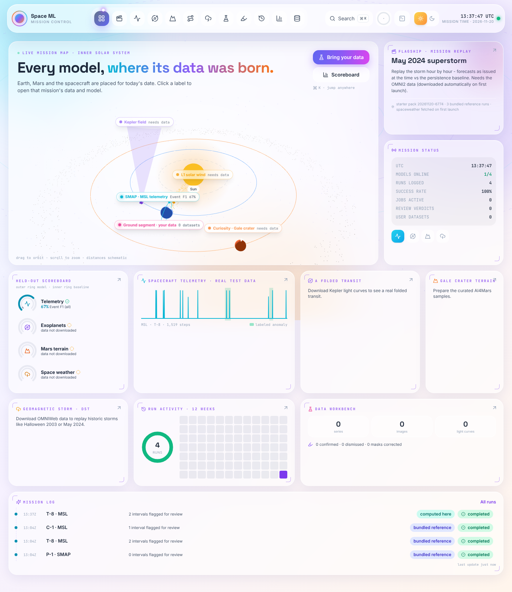

# Space ML Mission Control

Replay real space events, compare ML models with simple baselines on held-out data, review the results by hand and export the evidence, all on real NASA data. The dashboard and the API run as one app, locally or with one Docker command.

| Module | Real data | Model vs baseline | Output |
|---|---|---|---|
| **Mission Replay** (flagship) | NASA OMNIWeb OMNI2 hourly solar wind + Dst, May 2024 superstorm and 9 other storms | Gradient-boosting Dst forecaster (+1…+24 h) vs **persistence**, issued hour by hour with no look-ahead | What happened · what the model could know at the time · where the baseline did better · evidence ZIP |
| **Spacecraft Anomaly Detection** | NASA SMAP + Curiosity (MSL) telemetry, 105 expert-labeled anomalies | LSTM per channel + dynamic threshold vs z-score | Flags for review |
| **Exoplanet Finder** | Kepler DR24 TCEs + MAST light curves, or your uploads | 1D CNN vs gradient boosting; BLS search, odd/even + secondary checks, 3D system + sky | Candidate score |
| **Mars Terrain** + **Rover Traverse Explorer** | NASA/JPL AI4Mars; Curiosity waypoints (NASA/JPL MMGIS) + raw Navcam images | DeepLabV3+ vs all-soil; terrain along the drive by distance | Masks you can correct, located on the traverse |
| **Space Weather Explorer** | OMNI2 1963→ | Dst forecast vs persistence, chronological split | Storm replay, annotations |
| **Data Workbench** | Your CSV/XLSX/JSON/Parquet/FITS/PNG/GeoTIFF/zip | Robust anomaly flags vs z-score · change detection (km², NDWI) · terrain | Analysis + reproducible report |
| **Review Studio** | Every flag, region, candidate and mask | Confirm · dismiss · correct | Reviewed labels (CSV/JSON/ZIP) |



---

## A · Evaluators: one command (Docker)

```bash
docker compose up -d          # first build ~5-10 min; then open http://localhost:8080
```
No API keys, no GPU and no manual dataset setup. The image serves the dashboard and the API from the same origin (`/` and `/api`, docs at `/docs`).

What the first launch does (no terminal commands, ever):
1. **Serves immediately.** Nothing heavy runs at startup: no automatic downloads, no automatic training.
2. **Installs data once.** It installs the starter pack (`starter/`, about 35 MB, sha256-checked). This holds all 81 SMAP/MSL channels, a trained model for each and bundled reference runs, so anomaly detection works offline within seconds. If a **release bundle** sits in `./release/bundle` (see [Release bundle](#release-bundle-full-offline-deployment)), every dataset in it is verified and copied into the data volume once. Every dataset then shows **Ready**, offline.
3. **Data & Training** is a dataset catalog. It shows **Dataset ready** and **Model status** separately for each module. Each module has its own **Train** buttons:
   - **Quick run (pipeline check)** uses a small, seeded subset and takes minutes. It proves the pipeline works but is not a final model.
   - **Full training** runs on demand.
   Only one heavy job runs at a time, and the rest wait in a queue that says what they are waiting for. Training runs at low priority on capped CPU (`SPACEML_TRAIN_CPUS`), so the dashboard stays responsive. Clicking Start twice reuses the running job. A job interrupted by a restart keeps its checkpoint and shows **Resume**. The last working model stays active until a better one is published, and a full run is preferred over a quick one.
4. **GPU option for Mars.** Train in `notebooks/mars_training.ipynb` on Colab or Kaggle and upload `mars_model.zip` with **Upload a trained model**.

Give Docker at least 4 GB of memory. More cores make full training faster. A job that prints nothing for 30 minutes is stopped and can be retried. Set `SPACEML_AUTOSETUP=light|full` only if you want the old automatic download-and-train behaviour.

| | |
|---|---|
| Settings | `cp .env.example .env`: port, `SPACEML_AUTOSETUP` (default `off`), `SPACEML_TRAIN_CPUS`, `SPACEML_HEAVY_JOBS` (default 1), `SPACEML_MARS_WEIGHTS_URL`. Defaults work without it. |
| Data persistence | Named volumes `smc-data`, `smc-models`, `smc-storage` (SQLite runs/reviews/notes/jobs, results, uploads). `docker compose down` keeps them; `down -v` resets. |
| Training & data tools | `docker compose exec app python -m spaceml.telemetry.train --fast` or, with the app stopped, `docker compose --profile tools run --rm tools python -m spaceml.quickstart --stars 300` |
| Skip the build | Push a tag `v*`: `.github/workflows/image.yml` publishes `ghcr.io/<owner>/space-ml-mission-control:<tag>`; then `SMC_IMAGE=ghcr.io/<owner>/space-ml-mission-control:<tag> docker compose up -d` |
| Smaller image | `TORCH_INDEX=none docker compose build` gives a lite image without PyTorch (Mission Replay, Space Weather, Workbench, Exoplanet views; telemetry/Mars inference say clearly that they need the full image) |
| Offline machine | Download `omni2_YYYY.dat` elsewhere and upload them on the Mission Replay page |

## B · Contributors: native React/Vite + FastAPI

Requirements: Python 3.10–3.12, Node 18+.
```bash
./scripts/setup.sh  &&  ./scripts/dev.sh          # Windows: .\scripts\setup.ps1 ; .\scripts\dev.ps1
```
API on :8000 (auto-reload), dashboard on http://localhost:5173 (Vite proxy to the API). The API installs the starter pack (and a release bundle, if `SPACEML_BUNDLE_DIR` points at one) on first start. Training starts only from the UI.

<details><summary>Manual steps</summary>

```bash
python -m venv .venv && source .venv/bin/activate         # Windows: .venv\Scripts\activate
pip install torch --index-url https://download.pytorch.org/whl/cpu    # CPU wheels (optional on macOS/Windows)
pip install -r backend/requirements.txt
cd backend && uvicorn app.main:app --reload --reload-dir app --reload-dir spaceml --port 8000
cd frontend && npm install && npm run dev                  # second terminal
```
Serving the built dashboard from the API (like Docker): `cd frontend && npm run build`, then open http://localhost:8000.
</details>

---

## Multi-Mission Telemetry

Open **Telemetry** and pick a mission. **NASA SMAP / MSL** keeps its existing workflow. Every other source opens a shared workspace:
- **Replay:** a searchable, keyboard-navigable list of segments / exposures / visits, and a chart with time and unit axes, data gaps, missing readings, annotations, a text summary and a data table. Only the selected item and time range are read. Long series are drawn as a min/max envelope, and analysis always uses full resolution.
- **Quick train / Full training:** shown only where the source has labels to learn from. Jobs run one at a time on capped CPU threads, and the dashboard stays usable. A failed or cancelled job never replaces the last working model.
- **Score** an item, and run the **held-out evaluation**. Predictions and unusual intervals go to **Review Studio** (filter: Missions), where **Inspect** shows the signal, the published label and the prediction.

**Start** (no automatic training; missing small mission datasets download in the background when online - set `SMC_AUTO_INSTALL=off` in `.env` for a fully offline start):
```bash
SMC_PORT=8081 docker compose up -d          # then open http://localhost:8081/telemetry
```
Startup installs the starter pack: SMAP/MSL, its models, and the complete OPS-SAT release. Missions without local data are installed automatically when the app is online (see Version 3.1.5), or with one click on **Install data**; uploading files and the command line below remain optional.

| Mission | Shipped in this release | Training / evaluation | Status |
|---|---|---|---|
| ESA OPS-SAT | **Complete OPSSAT-AD v1** (Zenodo 10.5281/zenodo.12588359; the published `dataset.csv` + `segments.csv` byte-for-byte, md5 `c12fb838…` / `1f4b6ffd…`): 2,123 segments, 303,493 samples, 9 channels, 2022-01-04 → 2022-06-02; 22 MB prepared, CC BY 4.0 | RandomForest on the 18 published features, official split (1,594 / 529); segment-level confusion matrix, per-class P/R, false alarms, missed; single-feature threshold baseline | verified on real data |
| Hubble | importer only (`*_jit.fits` + `*_jif.fits`) | Isolation Forest per telescope, split by exposure; review candidates (no fault labels) | real data **not** verified (MAST unreachable from the build machine) |
| James Webb | importer only (FGS `*_gs-fg/track_*_cal.fits` POINTING tables) | Isolation Forest per telescope, split by visit; review candidates | real data **not** verified (MAST unreachable) |

**Preparing a source once** (inside the app container, on a machine that has the files or network access). The importers validate schema, units, timestamps, counts and gaps, record source IDs and checksums, and refuse unknown OPS-SAT files:
```bash
docker compose exec app python -m spaceml.missions.prepare opssat --download v2 --from /app/data/missions-source/opssat
docker compose exec app python -m spaceml.missions.prepare hubble --from /app/data/src/hst        # *_jit.fits + *_jif.fits
docker compose exec app python -m spaceml.missions.prepare webb   --from /app/data/src/jwst       # *_gs-fg_*_cal.fits
```
Prepared sources are included automatically in the next release bundle (`spaceml.release build --from-data --include-models`), with checksums, scope, counts, date ranges, attribution and redistribution terms.

**Disk space:** the starter pack adds 39 MB, and installed data plus models measured 0.3 GB on the test machine. The image size was not measured, because Docker images cannot be built in the build environment; with CPU PyTorch, expect roughly 1-1.5 GB. Allow **3 GB free**, plus the size of any release bundle you add.

## Mission Replay: the flagship

Open **Mission Replay** (second icon in the dock). For the May 2024 Gannon storm the screen answers three questions:
* **What happened?** Observed Dst and solar wind, with a timeline detected from the data: shock arrival, southward IMF, −50/−100/−250 nT crossings, peak, recovery.
* **What could the model know at the time?** Drag or play the issuance time. Each hour shows the forecasts issued then for +1/+3/+6/+12/+24 h, the 24 h of inputs the model used (shaded), and the future greyed out. The first storm warning is given with its lead time.
* **Where did the baseline do better?** Every issuance is marked green (model closer), red (persistence closer) or grey (tie within ±2 nT), with the longest stretches named and a scoreboard per horizon.

How it is kept honest:
- **Chronological evaluation.** Train 2010-2016, test 2017; overlapping splits are refused. A replay of a training year is flagged **in-sample**.
- **No look-ahead.** The server recomputes one forecast with all later data removed and the result must be identical ("no look-ahead" badge).
- **Data quality first.** Missing hours, gaps and stale readings are shown before the result. Statuses are distinct: *ready*, *usable with gaps*, *insufficient data*, *source unavailable*.
- **Provenance.** Each OMNI year records its URL, retrieval time, sha256 and Dst status: final up to 2020, provisional for 2021–2024 (2024 includes the storm).

## Reproducible evidence for every run

Every result (replay, telemetry, Mars, exoplanet, workbench) has an **Evidence** panel:
- **Evidence (.zip):** `manifest.json` (data source + sha256, data window, model version + every model file's sha256, training split, held-out metric, settings, baseline, metrics, reviewer verdicts and notes, software versions), `report.md`, `result.json`, CSV tables (`forecasts.csv`, `timeline.csv`, `flagged.csv`, `reviews.csv`) and images.
- **Repeat run:** the same input with the **same model version**, then compared value by value ("identical result · N values compared"). The API is `POST /api/runs/{id}/repeat` and `GET /api/runs/{id}/reproducibility`.

## Rover Traverse Explorer

Mars → **Rover Traverse**. Download Curiosity's waypoints (~0.7 MB, NASA/JPL MMGIS: site, drive, sol, lat/lon, distance driven) and click a waypoint. Navcam frames taken that sol come from NASA's raw-image API and are cached. **Segment terrain** runs the Mars model on a frame. The result opens with **Correct this mask**, and corrections flow into Review Studio exports.

Location precision is always shown on the map:
- **Exact:** the image's product id (characters 19–25 = site/drive) matches a surveyed waypoint.
- **Within site:** nearest earlier drive in that site.
- **Sol only:** only the sol is known; the image is placed at that sol's end-of-drive position.

Below the map, **terrain along the traverse** compares the predicted soil/bedrock/sand/rock shares per 0.5–5 km section, filterable by sol, dominant class and reviewed masks. Images from the official AI4Mars release (`python -m spaceml.mars.data samples --from-nasa …`) and uploads with NASA file names are located the same way. The Hugging Face copy of AI4Mars has no file names, so its samples are listed as "not located".

## Data Workbench: bring your own data

1. Open **Data Workbench**, drop a file or archive (≤ 1 GB). The type is detected automatically (or pick *Series / Images / Light curve*).
2. **Preview**: column types (numeric, binary, datetime, text), missing values, ranges, first rows and a plot; images with size, bands, GeoTIFF CRS and pixel size.
3. **It classifies the dataset** (e.g. "Mars rover surface imagery · Perseverance · Navcam", with the evidence) and **runs the recommended analysis automatically**. You can pick another compatible analysis; its settings form is pre-filled with detected time/label/sensor columns.
4. **Inspect the result**, confirm/dismiss each flag or region (review verdicts), compare runs in the experiment table, download the **Markdown report** or full **JSON** (dataset content hash, settings, model version, metrics, reviews).

| You upload | Analysis | Notes |
|---|---|---|
| Telemetry / sensor / space-weather table (e.g. OMNIWeb, MEDA exports) with a time or step column | Time-series anomaly flags | Optional 0/1 label column or typed intervals → event-level precision/recall for both detectors |
| Two aligned images or GeoTIFFs of the same place | Change detection | GeoTIFFs: area in km² (projected or lat/lon), "after" reprojected if grids differ. Water mode: NDWI from green + NIR bands (Sentinel-2: 3 & 8; Landsat 8/9, HLS L30: 3 & 5) |
| Any image collection, e.g. a zip of rover photos | Classify & summarise images | Per image: region map (terrain / rover hardware / shadow / sky), scene type, ground-roughness heat map, rocks & pebbles, exposure/sharpness, duplicates, stereo pairs; charts for the whole set; terrain classes on terrain pixels when the Mars model is installed. Each image's classification can be confirmed in Review Studio |
| Rover image (+ optional `*_mask.png` with AI4Mars class ids) | Terrain segmentation | Needs the Mars model |
| Light curves: Kepler/K2/TESS FITS, or tables with time + flux/mag | Transit search → Exoplanet Finder | BLS period search or your own ephemeris; JD/BJD/BTJD/BKJD/MJD handled |

**Try it:** `samples/` contains CSVs built from the real SMAP/MSL test telemetry with NASA's expert labels as an `anomaly` column (e.g. `smap_P-1_test_with_labels.csv`). `python -m spaceml.workbench.samples imagery` downloads real NASA GIBS MODIS before/after GeoTIFFs (Lake Mead 2000 vs 2022, Indus flood 2021 vs 2022) as ready-to-upload zips — check them for clouds. You can also export two dates from [NASA Worldview](https://worldview.earthdata.nasa.gov) (Take snapshot → GeoTIFF).

**Units & masks:** set a unit per column in the settings (shown on plots and in the report). In Mars results click **Correct this mask** to paint the right terrain class; corrected masks are stored as reviews.

**Experiments:** tick two or more runs in the experiment table → **Compare** shows settings that differ, metric bars and the flags each run got wrong (missed / false alarms).

**Review Studio:** one queue for telemetry flags, workbench intervals and change regions, transit candidates and terrain masks. Confirm, dismiss or correct, then export reviewed labels as CSV, JSON or a ZIP (with corrected masks as PNG) to retrain models.

**Adding a new analysis** = one entry in `backend/spaceml/workbench/analyses.py` (input kind, settings, output viewer, evaluation) plus a `run()` function. The API validates requests against the declaration and the frontend renders its form and viewer.

## Data & training commands (optional - for contributors)

You never need these in Docker: the **Data & Training** page runs them for you. The page runs all of these as background jobs with progress, ETA, logs, cancel and **Retry**. The `>_` switch in the top bar shows the commands.

| Step | Local (`backend/`) | Docker |
|---|---|---|
| Health check | `python -m spaceml.doctor` | `docker compose exec app python -m spaceml.doctor` |
| Space weather: everything (download → train → replay) | `python -m spaceml.spaceweather.data download --years 2010 2011 2012 2013 2014 2015 2016 2017 2024 && python -m spaceml.spaceweather.forecast --if-missing && python -m app.starter replay --event 2024-05` | prefix each with `docker compose exec app` |
| Import OMNI files you downloaded | `python -m spaceml.spaceweather.data import omni2_2024.dat` | same prefix |
| Curiosity waypoints | `python -m spaceml.mars.traverse download` | same prefix |
| Full telemetry set + train the other 70 channels (fast) | `python -m spaceml.telemetry.data download && python -m spaceml.telemetry.train --fast --version v1-sandbox && python -m spaceml.telemetry.evaluate --version v1-sandbox` | same prefix |
| Kepler catalog + light curves + CNN | `python -m spaceml.quickstart --skip-telemetry --skip-mars --stars 300` | same prefix |
| AI4Mars local dataset (validated pairs) | `python -m spaceml.mars.local build --train 3000 --test all` · check: `python -m spaceml.mars.local check` | same prefix |
| Mars samples / quick / full / resume | `python -m spaceml.mars.data samples --n 36` · `python -m spaceml.mars.train --quick` · `--resume` | same prefix |
| Release bundle build / verify / install | `python -m spaceml.release build --out ../release/bundle` · `verify` · `install` | `docker compose --profile tools run --rm tools python -m spaceml.release build --out /bundle-out` |
| Starter pack status / rebuild | `python -m app.starter status` · `python -m app.starter build --with-network` | same prefix |

Fast defaults: telemetry trains in parallel on every 4th window (`--fast`, about 10× quicker, same detections on the shipped channels). Kepler downloads 8 of 17 quarters per star with 6 workers. CPU Mars training uses 300 images × 3 epochs.

**Building a full offline starter pack.** On a machine with internet, `python -m app.starter build --with-network` adds OMNI2 2024, the trained forecaster and a May 2024 reference replay to `starter/`. Commit the folder, and fresh machines replay the storm without any download.

## Release bundle: full offline deployment

A release is the Docker image plus **one versioned folder**, `release/bundle/`. The folder holds `manifest.json` and `datasets/<id>/…`. The manifest pins, for every dataset, its source and revision, its splits and date ranges, the Kepler targets and quarters, file counts, sizes, a sha256 for every file, the attribution and the redistribution terms.

| Dataset | What ships | Prepared form |
|---|---|---|
| `telemetry` | NASA SMAP/MSL, all 81 channels and the 105 labeled anomalies | `.npy` arrays + labels |
| `kepler` | DR24 TCE catalog + light curves for `--kepler-stars` targets, `--kepler-quarters` quarters each | folded global/local views (`.npz`) + `targets.json` (targets and quarters used) |
| `ai4mars` | AI4Mars train subset (`--ai4mars-train`, default 3000) + the expert-labeled test split, plus 36 review samples | validated image/label PNG pairs + `index.json` (revision, rows read/kept/skipped per split) |
| `omni2` | OMNI2 hourly, years in `--omni-years` (including 2024 for the May 2024 replay) | parsed yearly files |
| `traverse` | Curiosity waypoints and drive geometry | GeoJSON/JSON |
| `flood` | Satellite flood scenes (NASA GIBS) for the Workbench demo | zip per event |

**Building it (on any machine with internet, once).** Downloads and preprocessing run here, so the machines you deploy to never need the network:
```bash
docker compose --profile tools run --rm tools python -m spaceml.release build --out /bundle-out            # downloads + prepares
docker compose --profile tools run --rm tools python -m spaceml.release build --out /bundle-out --from-data --include-models   # package what you already have (+ trained models)
```
On Linux, if the bind mount is not writable for the container user, run `mkdir -p release/bundle && chmod a+rwx release/bundle` first.

**Deploying.** Copy the project folder together with `release/bundle/` to the target machine and run `docker compose up -d`. On first start, each file is checked against its checksum and copied into the data volume. Only missing or changed files are copied on later starts. The catalog shows the bundle version, size, verification state and free disk space. **Re-verify** and **Install** buttons are there as well.

**Size and disk space.** The build prints the exact size and records it in `manifest.json`. With the defaults, expect roughly **1-1.5 GB**. AI4Mars images are most of it, and `--ai4mars-train all` makes it several GB. Free space needed on the target is about **2× the bundle size + 3 GB** (bundle, installed copy, models, runs and checkpoints).

**Redistribution.** The NASA sources (PDS, MAST, OMNIWeb, GIBS) are public. AI4Mars is marked `verify` in the manifest: confirm its license terms before you hand the bundle to third parties.

**Acceptance test.** On a clean machine with Docker, go offline and start the app:
1. Every dataset in the catalog shows **Ready**.
2. Open the May 2024 replay.
3. Start Mars and Kepler training from the UI. Kepler waits in the queue behind Mars.
4. Restart the app. Jobs come back as *interrupted* with **Resume**, and published models are still there.

Kepler ingestion (when building) is checkpointed per star and per quarter, so a restart during a download resumes from the last completed file.

## Deployment audit

`scripts\audit.ps1` (Windows) or `scripts/audit.sh` runs the whole acceptance check against the real container. The app runs on `localhost:8081` with external network access cut off (`docker-compose.offline.yml`).

1. **Mounts.** It confirms that `/app/data`, `/app/models` and `/app/storage` are on named volumes before anything is recreated, and stops if the old container uses anonymous volumes. `-Backup` first saves the three volumes to `.\backup`.
2. **Rebuild.** The image is rebuilt with the matched CPU torch/torchvision pair.
3. **Runtime check.** `pip show`, `pip check`, and `torchvision.ops.nms` run on CPU inside the container that runs the jobs.
4. **`spaceml.audit data`.** Every local dataset is inventoried and validated: counts, splits, shapes, label/class ids, train/test separation, Dst coverage. Each count is compared with the intended release scope, so a local subset is marked **LOCAL SUBSET**.
5. **`spaceml.audit ui`.** It uses the same HTTP API the buttons use:
   - **Quick training** for each trainable module. A run passes only when the job succeeded, a new model version with artifacts exists, and an inference run pinned to that version succeeded.
   - **Analysis-only workflows:** traverse render, change detection with its area result, and the review queue.
   - **Full Training controls:** each must point at the full local split and make real progress. The audit then cancels it, unless you pass `-WaitFull`.
6. **Restart persistence.** Datasets, models, job history and checkpoints must survive `docker compose restart`, and startup must not start any job.
7. **Report.** The results go to `audit-results/report.md`, one row per module. Anything not exercised is marked UNTESTED.

Audit models are written as separate versions (`audit-*` for telemetry, `*-quick` for the others). The active-model rules never let them replace a fuller model.

## Reliability

* **Jobs** run as subprocesses with persisted state. If the server stops, running jobs become **interrupted** (not "failed"), and **Retry** reruns them with the same settings.
* **Outputs are published atomically.** Models train into `.staging-<version>/` and are renamed when complete. Runs write to `.<id>.partial/`. Downloads go to `*.part` first. A crash never leaves half a model or result behind.
* **Kepler downloads** are checkpointed per star and per quarter (`lightcurves/quarters/<kepid>/`). Each quarter has its own timeout and bounded retries, and one unavailable quarter does not block the star or the batch.
* **Preflight before training.** Mars validates image/label pairs (sizes, class ids) and Kepler validates view shapes and finite values. Both then run one training batch, so a bad dataset fails in seconds with the real error instead of after hours.
* **Downloads** have timeouts, bounded retries with backoff, an on-disk cache and a provenance sidecar. Failures surface as `source_unavailable` with a readable reason.
* **One instance by default.** SQLite plus the volumes are enough. Move to a shared database or queue only when you need several workers.

## Architecture
```
Browser ──/ and /api──► FastAPI (one origin; serves frontend/dist)
  React + Vite + TS + Tailwind,           ├─ run worker (thread pool) ─► spaceml.{telemetry,exoplanet,mars,spaceweather,workbench}
  Plotly, three.js                        ├─ job runner (python -m … subprocesses, progress, logs, retry)
                                          ├─ starter pack installer (sha256-verified) + first-launch bootstrap
                                          └─ SQLite: runs (origin, repeat_of) · model_versions · evaluations · jobs · reviews · annotations
data/   models/<module>/<version>/ (manifest, metrics, auto-detected)   storage/ (db, runs, uploads, logs)   starter/ (pack.json + files + reference runs)
```

## Tests
```bash
cd backend && python -m pytest -q        # 51 tests, no network needed
```
They cover the API, the pipelines and the following:
- **OMNI2 parsing** checked against **real NASA OMNI2 rows** (`tests/data/omni2_2000_excerpt.dat`), with a column-shift guard based on E = −V·Bz and Pdyn = 2·10⁻⁶·N·V².
- **Mission Replay:** causality, persistence, timeline, manifest, evidence ZIP, Repeat → identical.
- **Jobs and starter pack:** interrupted/retry jobs; starter-pack build, install and tamper detection; integrity of the shipped pack.
- **Bundled data:** a **real bundled telemetry run repeated offline with identical results**.
- **Release bundle and job queue:** bundle build, install and tamper detection; reuse on double Start; queued job says what it waits for; final-exception error messages.
- **AI4Mars loader:** unlabeled rows skipped and counted, schema errors report the row keys. **Kepler:** restart mid-download resumes from the last completed quarter.
- **Traverse Explorer:** id parsing, locating images, sections, non-NASA hosts refused.

## Release checks run for this version (sandbox)
| Check | Result |
|---|---|
| Clean `docker compose up -d` (fresh volumes) | healthy; dashboard, assets, `/docs` and `/api` served from one origin; starter pack installed with hashes verified; bundled runs listed |
| Persistence | reviewer note kept across `restart` and `down`/`up` |
| Job interrupted by restart | marked *interrupted*; Retry resubmits it |
| Upstream outage | NASA hosts unreachable → space weather and waypoints report *source unavailable*, nothing presented as a result |
| Real starter-pack analysis | bundled telemetry run repeated → identical |
| Telemetry 3D view after a completed run | renders (browser screenshot) |
| Test suite | 34/34 locally (Python 3.13); 12 offline tests inside the container (Python 3.12) |

**Limits of this sandbox, stated plainly:**
- **Docker:** Docker Hub, the PyTorch wheel index and NASA were blocked. Compose was therefore tested with an Ubuntu 24.04 stand-in base and the lite image (`TORCH_INDEX=none`), not the official `python:3.11-slim`/`node:20-alpine` images or the CPU-PyTorch layer.
- **Space weather:** the real May 2024 replay, the waypoint download and raw images could not be fetched here. Those features were exercised with QA-only stand-in files that are **not shipped**. They download on your machine on first use.

## Troubleshooting
| Symptom | Fix |
|---|---|
| A dataset is not Ready | Put a release bundle in `release/bundle/` (see above), or use **Download** on its catalog card. "Source unavailable" means that NASA/Hugging Face host was unreachable; press **Retry** later. |
| Mars model is slow / low accuracy | A quick run is only a pipeline check; run **Full training**, or train the GPU model in Colab/Kaggle and upload `mars_model.zip` (Mars page → Upload a trained model). |
| Training killed / container restarts | Give Docker more memory (Settings → Resources, 4 GB+). Interrupted jobs show **Retry**. |
| Mars Quick run: "expert test images are also in the training pairs" | Fixed in 3.1.1. When the Hugging Face rows have no file name, the pairs are named by row number, so `train/row000042` and `test_min3/row000042` are different images. The old check compared names. Images are now compared by a hash of their decoded pixels, which is recorded in `index.json`. An exact duplicate of an expert test image is held out of training and reported, not fatal. `python -m spaceml.mars.local check` prints the dataset root and the usable / held-out counts per split. |
| `operator torchvision::nms does not exist` | torch and torchvision come from different builds (e.g. CPU torch + PyPI/CUDA torchvision). Rebuild the image: it installs a matched pair (`TORCH_VERSION`/`TORCHVISION_VERSION`, default 2.6.0/0.21.0) from the CPU index, locks it with `PIP_CONSTRAINT`, and fails the build if `torchvision.ops.nms` doesn't work. |
| "needs PyTorch" | You built the lite image. Run `docker compose build --no-cache` with the default `TORCH_INDEX` (or `pip install -r backend/requirements.txt`). |
| Port 8080 busy | Set `SMC_PORT=8081` in `.env` |
| Exoplanet training: "Not enough cached light curves" | Download more stars (`--stars 300+`) |
| Change detection: "barely overlap" | Export both dates with the same bounding box |
| Theme looks wrong after an update | Hard refresh (Ctrl+Shift+R) |

## Version 3.1.10 — dedicated project landing page (/welcome)

* **Welcome landing page (`/welcome`).** A polished, full-feature introduction to Space ML Mission Control:
  - Hero with product overview, value statement, dual CTAs (*Open Mission Control* and *Bring your data*), and a lazy-loaded 3D Mission Map (lightweight glowing orb on mobile).
  - Live system status strip reporting real metrics from `/api/catalog` and `/api/overview` with count-up animations and graceful offline fallback.
  - Interactive 8-module grid dynamically driven by the navigation metadata.
  - Real-time "What is Webb observing now?" live observation teaser powered by `/api/live/webb`.
  - 3-step operational workflow (*Install data* → *Train / analyse* → *Review*) linking directly to core features.
  - Full support for dark/light themes, zero accessibility violations (WCAG 2.1 AA), and strict prefers-reduced-motion compliance.
  - Dismissible "New here? Take the tour" prompt on the main Overview.

Upgrade exactly as for 3.1.9 below (`docker compose up -d --build app`); existing volumes are preserved.

## Version 3.1.9 — live telescope view inside the app, clearer map, full-size rover images

* **Hubble / Webb live view in the app.** Mission pages now show what the telescope is observing without leaving the app:
  target, program title, science category, instruments, PI, start / end (UTC, local time on hover), a progress bar with time
  left, the next observation, RA / Dec, and a sky picture of the target region at three fields of view (0.1°, 0.5°, 2°).
  It refreshes every minute while the page is open (and on **Refresh**). The data comes from NASA / STScI Space Telescope
  Live, which cannot be embedded in other sites, so the backend reads the public JSON its own page uses
  (`/api/live/{hubble|webb}`) and caches it in the storage volume. Offline, the last known observation and its sky picture
  stay visible, marked *Offline · last known*; "Earlier observations seen by this app" lists what was fetched before.
  The sky picture is a ground-based DSS2 survey image (CDS hips2fits) - Hubble and Webb images are not released in real
  time, so no live telescope image exists anywhere. Space Telescope Live's JSON is undocumented and was not reachable from
  the build machine; it is parsed defensively and tested against recorded field names, and if it changes the panel shows
  a calm notice instead of an error. `SMC_LIVE_MAX_AGE` (seconds, default 120) sets how often it is refreshed.
* **Mission map.** The Earth system is drawn 1.5× larger, satellites sit on wider orbits, every spacecraft has its own
  name tag, and tags never cover each other (they are moved apart automatically). A spacecraft bar under the map
  (SMAP, OPS-SAT, Hubble, James Webb, ACE · DSCOVR, Kepler, Curiosity) flies the camera to any of them and follows it;
  **Open** goes to its data, **Back** returns. The map controls moved under the map, so nothing covers the scene.
* **Rover Traverse images.** The image panel now fills the height of the map (no more cut-off second row), uses 4:3
  thumbnails in 2-3 columns, and any image opens full size (Esc or click to close).

Upgrade exactly as for 3.1.8 below, using the 3.1.9 ZIP (`docker compose up -d --build app`); volumes are reused.

## Version 3.1.8 — focused on OPS-SAT, Hubble and Webb

**Removed:** ESA Missions 1-3, FUNcube-1 (AO-73) and SatNOGS UWE-4. Their importers, install buttons, token settings
(`SATNOGS_TOKEN`), map spacecraft, tests and the `satnogs-decoders` package are gone, so their download errors
(Zenodo `IncompleteRead`, SatNOGS HTTP 429, FUNcube "stopped by a restart") can no longer appear. Old jobs of those missions
are hidden from the job list. Everything else (SMAP/MSL, OPS-SAT, Hubble, Webb, Kepler, Mars, space weather, the workbench,
Review Studio) is unchanged, and your volumes, datasets, models, job history and reviews are kept.

The mission install panel is now one card: what will be downloaded, one **Install data** button, and an optional upload.

### Upgrade on Windows (PowerShell) - keeps your Docker volumes

```powershell
cd C:\path\to\space-ml-mission-control            # the SAME folder as before: the volume names come from it
docker compose down                                  # never add -v (that deletes the volumes)
Expand-Archive -Path $HOME\Downloads\space-ml-mission-control-3.1.8.zip -DestinationPath $env:TEMP\smc318 -Force
robocopy "$env:TEMP\smc318\space-ml-mission-control" . /E /XF .env   # replaces project files, keeps your .env
docker compose up -d --build app
docker compose ps
```

You can delete the `SATNOGS_TOKEN=` line from `.env`; it is ignored now.

**Optional cleanup** of space used by the removed missions (partial ESA archives can be several GB). Nothing is deleted
automatically; run this only if you want the space back:
```powershell
docker compose exec app sh -c "rm -rf /app/data/missions-source/cache /app/data/missions-source/esa-m* /app/data/missions-source/funcube /app/data/missions-source/satnogs /app/data/missions/esa-m* /app/data/missions/funcube /app/data/missions/satnogs"
```

## Version 3.1.7 — fixes from real installs

Upgrade exactly as for 3.1.6 (PowerShell commands below), using the 3.1.7 ZIP; `docker compose up -d --build app` is
required because a new Python package (`inflate64`) is installed into the image.

* **ZIP uploads** stored with Deflate64 (ZIP method 9) are readable; an archive using any other unsupported method is
  rejected before extraction with the method named.
* **Hubble / OPS-SAT "no item" errors** came from the previous mission's selection leaking into the next one when switching;
  every mission page now starts with its own state.
* **OPS-SAT "Model: not trained"** although a model existed: models trained on another data version were hidden. They are
  shown again (with a "retrain recommended" note when the data version differs).
* **Review step count** on mission pages (HTTP 422) fixed.
* **Mission map:** the 3D scene was rebuilt on every catalog refresh (every 2.5-12 s), which reset any rotation or zoom.
  It is now built once; labels update in place. Real spacecraft models replace the placeholder blocks (Hubble, Webb with
  gold mirror segments and sunshield at L2, Kepler, SMAP, a CubeSat for OPS-SAT); particles are
  round. Controls: drag, wheel, arrow keys and + / -, plus buttons to rotate, zoom, pause, fly to an Earth-orbit close-up
  and reset. Hover a spacecraft to see its name, click it to open its mission.

## Version 3.1.6 — reliable mission downloads, one readiness definition

### Upgrade on Windows (PowerShell) - keeps your Docker volumes, datasets, models, jobs and reviews

```powershell
cd C:\path\to\space-ml-mission-control            # the SAME folder as before: the volume names come from it
docker compose down                                  # stops the app; never add -v (that deletes the volumes)
docker volume ls --filter name=smc-                  # expect <folder>_smc-data, _smc-models, _smc-storage
# optional backup of runs, reviews and jobs
docker run --rm -v space-ml-mission-control_smc-storage:/v -v ${PWD}:/b alpine tar czf /b/smc-storage-backup.tgz -C /v .
Expand-Archive -Path $HOME\Downloads\space-ml-mission-control-3.1.6.zip -DestinationPath $env:TEMP\smc316 -Force
robocopy "$env:TEMP\smc316\space-ml-mission-control" . /E /XF .env   # replaces project files, keeps your .env
docker compose up -d --build app
docker compose ps
```

If the project folder has a different name than before, set `$env:COMPOSE_PROJECT_NAME = "<old folder name>"` first so
Compose reuses the existing volumes. `.env` is excluded from Git, from the Docker build context and from this ZIP.

### What changed

* ESA Missions 1-3, FUNcube-1 and SatNOGS UWE-4 were part of this release and were removed in 3.1.8.
* **Hubble / Webb live feeds** opened the official Space Telescope Live viewer in a new tab (replaced in 3.1.9 by an in-app view). Archived pointing data, replay and training are unaffected by the live feed.
* **One readiness definition** on Overview, Missions and Data & Training: **Missing · Installed · Ready to train ·
  Model available · Analysis only**, refreshed automatically when install or training jobs finish. Mission pages show the
  running install job and the last failure in place.
* **Offline:** with no network the app starts normally (automatic install is skipped), and installed data, training,
  analysis, models, job history and reviews keep working.

### Verification for this release (build machine without access to MAST)

| Mission | Source path | Ingestion | Replay / analysis | Training | Remaining blocker |
|---|---|---|---|---|---|
| Hubble / Webb | MAST (Install data) / external live viewer | Unchanged from 3.1.5 | Webb replay + scoring run in the browser (offline) | Webb quick model scores; Hubble needs data | Bundled 2022 Webb copy has a collapsed time axis - use **Re-download Webb data** once online |
| OPS-SAT | starter pack v1 | installed | segment prediction | Quick train → model → held-out evaluation completed in the browser with the network disabled (F1 0.903 vs 0.754) | - |
| SMAP / MSL | starter pack | installed | anomaly detection run completed offline | existing models | - |

## Version 3.1.5 — automatic data, labeled-window datasets, a real review workspace

**Mission data installs itself.** With `SMC_AUTO_INSTALL=on` (default) the app checks for internet at startup and queues
an install job for every mission whose data is missing and whose source is small and public:

| Mission | Automatic source (no file names needed) |
|---|---|
| Hubble | the 12 newest public observations with jitter logs (`_jit` + `_jif`), found through the MAST CAOM API |
| James Webb | the newest public fine-guidance (`gs-fg` cal) files, one per visit, 10 visits, via MAST `Mast.Jwst.Filtered.GuideStar`; files still in their exclusive-access period are skipped |
| OPS-SAT | OPSSAT-AD v2 from Zenodo |

Every mission page also has one **Install data** button that does the same, and **More options** for specific files or an upload.
These sources could not be reached from the build machine; their request formats follow the MAST documentation and are covered by
tests with recorded responses. If a source changes, the job fails with a readable message and the upload path still works.

**Dataset versions.** Installing newer data never deletes the old data: the previous store is kept as an earlier version
(up to 4). Step 1 on each mission page has a **Version** picker and **Get newest data**. Models remember which data version
they were trained on: after switching, a model trained on another version is marked and **Quick train** is offered for the
selected one. The bundled 2022 Webb visits stay available next to the newest ones.

**Workbench: labeled windows (e.g. solar flares).** JSON / JSON Lines records with a label and parameter series - the
SWAN-SF benchmark used by the IEEE BigData 2020 flare-prediction cup (`train_partition*_data.json`) - upload as a
*Labeled windows* dataset (this was the "Trailing data" error). You get class balance, the parameters that separate flaring
from quiet regions, per-class trajectories, and **Predict the label of each window**: a random forest on window features
compared with the classic single-parameter threshold, scored with TSS and HSS (the flare-forecasting scores; accuracy is
misleading when flares are rare). With several partitions in one upload, every partition is tested by a model trained on the
others. Misses and false alarms go to Review Studio. JSON Lines also works for ordinary tables now.

**Review Studio** is a two-pane workspace: the queue (filter by module, repeated flags from re-runs shown once) and, for the
selected item, its evidence - the signal around a telemetry flag with the threshold, a mission alert on its time series,
before/after/change images for a region, the folded light curve of a transit candidate, a flare window next to the class
medians - plus Real / False alarm / Unsure buttons (keys 1 / 2 / 3, ↑ ↓ to move) and a note.

**Mission pages** plot each channel in its own panel (a large channel no longer flattens the others), zoom to the typical
0.5-99.5 % range with a **Show full range** toggle, and show duration, cadence, gaps, flags and per-channel statistics.
The overview map now shows Webb at Sun-Earth L2 and the Earth-orbit missions.

## Version 3.1.4 — easier to use, one status everywhere

**Navigation.** The top bar has labeled groups: **Overview · Missions ▾ · Data & Training · Analyze ▾ · Review Studio** (on phones: a labeled bottom bar plus a grouped **Menu**). Every mission page has the same four steps across the top: **1 Data → 2 Train → 3 Analyze → 4 Review**, each with its status and a direct action.

**One status definition, used by Overview, Data & Training, module pages and mission pages** (served by `/api/catalog` → `summary` and each entry's `status`; refreshed automatically while a job runs and when it finishes, with no Rescan needed):

| Term | Meaning |
|---|---|
| **installed** | the data is on this machine and can be explored |
| **ready to train** | installed data that meets the trainer's requirements |
| **browse only** | installed, but not enough labeled examples to train (Kepler shows the planet-candidate / false-positive counts and how many more are needed) |
| **needs re-import** | installed data known to be wrong; one button re-imports it |
| **models available** | a trained model exists and can produce results |

Each dataset card has **one highlighted next step** (Install data · Quick train · Resume · View latest result · Open). Raw commands are under **Setup help**.

**Install data in the app.** Missions without local data show an **Install data** panel. You can **download** from the official source (OPS-SAT/Zenodo, Hubble and Webb/MAST by file name or rootname) or **upload** the files you already have. The importer validates the data before anything is installed, and the mission page updates when the job finishes.

**Live telescope feeds.** Space Telescope Live does not allow embedding (the "refused to connect" panel). Hubble and Webb pages now offer an **Open live feed** button that opens the official viewer in a new tab, kept separate from the archived pointing data, which works offline.

**Webb timestamps fixed.** The JWST guider `POINTING` table stores `Time` in **MJD days**. Earlier releases read it as milliseconds, which squeezed each visit (about 4 minutes of 15.6 Hz samples) into a few microseconds. The importer now uses the column unit (or infers it from the values and cadence) and refuses to install a store whose clock collapses. A Webb store imported by an older release is flagged **needs re-import**, with a **Re-download Webb data (fix timestamps)** button that fetches the same 10 MAST files again (about 50 MB, needs internet). Re-verifying the release bundle never overwrites a mission store that you re-imported locally.

**Also:** faster first page (torch is no longer loaded to list datasets, and summaries are warmed at startup), explicit loading states (Traverse, Telemetry), no horizontal scrolling at 375/768/1280 px, and axe WCAG 2.1 AA clean on the main pages in light and dark themes.

## Version 3.1.2 — offline data and telescope observing feeds

*(Superseded in 3.1.4: the live viewer opens in a new tab, because the site refuses embedding.)* Archived pointing analysis uses local FITS-derived datasets.

Train actions for Kepler, AI4Mars, and OMNI2 use installed data. Use the separate Download action to install inputs. An OMNI2 training run can complete without the May 2024 replay input. The CPU queue intentionally limits heavy jobs by default. Curiosity waypoint downloads and jobs for different telemetry missions can proceed independently.

This source distribution includes a verified release-data manifest for the NASA/JPL Curiosity traverse and two NASA GIBS imagery pairs (Lake Mead and the Indus flood). SMAP/MSL and OPS-SAT are in the existing starter pack. Kepler, AI4Mars, OMNI2, and Hubble/Webb pointing archives require their own locally prepared datasets if absent from your volumes.

### Upgrade on Windows

Copy the new project files into the existing project folder so Compose resolves the same named volumes. In PowerShell:

```powershell
$env:SMC_PORT = "8081"
docker compose up -d --build app
```

This ZIP contains the full source project and bundled data listed above. The first image build needs access to the configured registries and package repositories. Once built, the bundled workflows can use the local image and data without outbound access.

## Webb pointing data update

The release bundle includes a prepared subset of public JWST Fine Guidance Sensor
telemetry from MAST program 2732: one guide product per visit across 10 visits. *Bundles built before 3.1.4 carry a wrong time axis for these visits; see “Webb timestamps fixed” above.*
The manifest records the exact products and checksums. Quick Train was verified
on seven visits with three held out. Alerts are review candidates; there are no
fault labels. The official live observing view is available independently.
